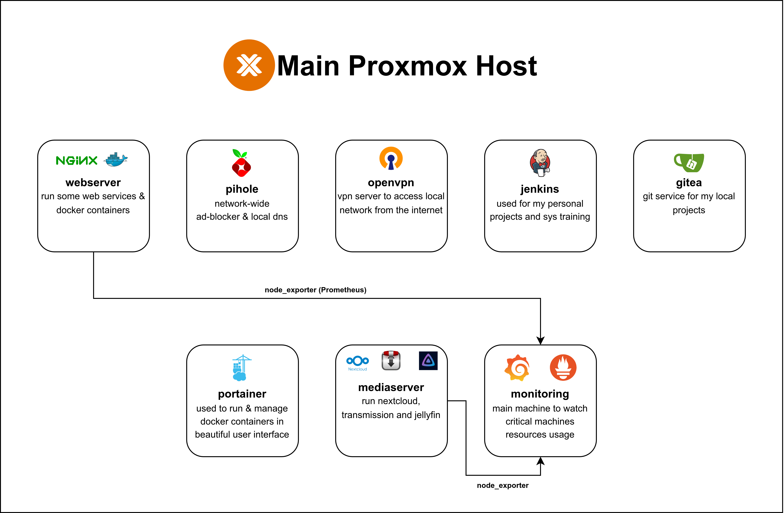

# Self-Hosted

Docker Compose files and supporting scripts from my home server.



The repository contains configurations for Homepage, Nextcloud, Nginx Proxy
Manager, Portainer, and Transmission. It also includes an Ansible playbook for
copying TLS certificates and a Cloudflare DNS update script.

These files contain host-specific ports, paths, addresses, and time zones. Review
them before use. For services with an `.env.start` file, copy it to `.env` and
replace the example values.

Start one service from the repository root with:

```sh
docker compose -f <service>/compose.yml up -d
```

Setup notes are available in the
[related blog post](https://kraaakilo.com/blog/mon-setup-self-hosting).
